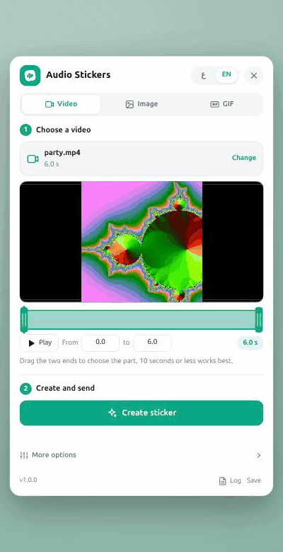
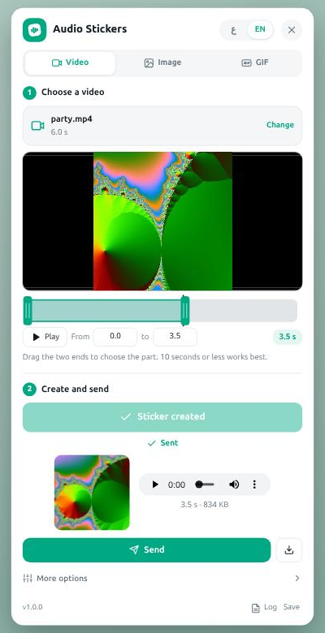
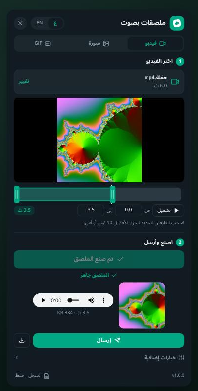
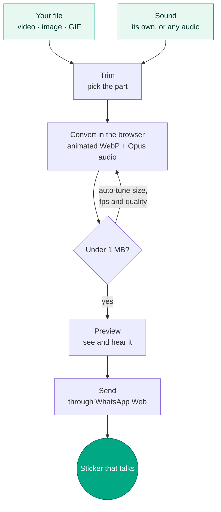

<div align="center">



<br><br>

**Make stickers that talk.** Pick a video, an image or a GIF, choose the part you want, add a sound, and send it to any chat in WhatsApp Web. One panel, three clicks, done.

<br>

[-00a884?style=for-the-badge&logo=googlechrome&logoColor=white)](#install-in-60-seconds)
[](#firefox)
[](#arabic-and-english)
[](#privacy)
[](https://github.com/KaraBala10/whatsapp-audio-stickers/stargazers)

[**Install**](#install-in-60-seconds) · [**How it works**](#how-it-works) · [**Features**](#features) · [**FAQ**](#faq)

</div>

---

## See it in action

<div align="center">

<br>
<sub>Choose a video → drag the green handles → <b>Create sticker</b> → <b>Send</b>. That's it.</sub>
</div>

<br>

## Features

<table>
<tr>
<td width="33%" valign="top">

### Three ways to make one
**Video** with its own sound, a still **Image** plus any sound, or a **GIF** plus any sound.

</td>
<td width="33%" valign="top">

### Trim with your eyes
A live preview and a waveform show exactly what you get. Drag two handles, press play, done.

</td>
<td width="33%" valign="top">

### Always under 1 MB
WhatsApp rejects stickers over 1 MB. Size, frame rate and quality are picked for you automatically, so it just fits.

</td>
</tr>
<tr>
<td valign="top">

### Hear it before you send
The finished sticker plays with its sound right in the panel. Click it to replay.

</td>
<td valign="top">

### Send anywhere
To the open chat, or to your own chat and then forward it to as many chats as you like.

</td>
<td valign="top">

### Arabic and English
A full Arabic interface with a real right-to-left layout, and English. Switch with one click.

</td>
</tr>
<tr>
<td valign="top">

### Drag and drop
Drop a file straight onto the panel. MP4, MOV, WebM, GIF, PNG, JPG, MP3, M4A, WAV and more.

</td>
<td valign="top">

### Light and dark
Follows WhatsApp's theme automatically.

</td>
<td valign="top">

### Nothing leaves your computer
Every conversion runs in your browser. No server, no account, no tracking.

</td>
</tr>
</table>

## Arabic and English

<div align="center">
<table>
<tr>
<td align="center"><br><sub><b>English</b> · light</sub></td>
<td align="center"><br><sub><b>العربية</b> · dark</sub></td>
</tr>
</table>
</div>

- **Full Arabic support (العربية):** every label, message and error is translated, and the layout flips to right-to-left.
- The switch at the top of the panel (**ع | EN**) changes the language instantly. Your choice is remembered.
- On first launch, the panel follows your browser's language.
- The extension's name in your browser also appears in Arabic or English, following the browser's language.

## Install in 60 seconds

1. **Download** this repository: click **Code → Download ZIP** above and unzip it (or `git clone https://github.com/KaraBala10/whatsapp-audio-stickers.git`).
2. Open `chrome://extensions` in Chrome, Edge, Brave or any Chromium browser.
3. Turn on **Developer mode** (top right).
4. Click **Load unpacked** and choose the `whatsapp-audio-stickers` folder.
5. Open [web.whatsapp.com](https://web.whatsapp.com), then click the extension icon in the toolbar.

> [!TIP]
> Pin the extension (puzzle icon → pin) so the button is always one click away.

### Firefox

Needs Firefox 140 or newer.

1. Download this repository as above.
2. Open `about:debugging#/runtime/this-firefox` in Firefox.
3. Click **Load Temporary Add-on…** and choose the `manifest.json` file inside the folder.
4. Open [web.whatsapp.com](https://web.whatsapp.com), then click the extension icon in the toolbar.

> [!NOTE]
> Firefox removes temporary add-ons when it closes, so you need to load it again after restarting Firefox.

## How it works



Under the hood:

| Step | What happens | Technology |
|---|---|---|
| Read | Frames are pulled from the video or GIF | `<video>`, `ImageDecoder` |
| Fit | Every size and frame rate is estimated, the best one under 1 MB is chosen | Canvas, size estimation |
| Encode picture | Frames become an animated WebP sticker (512 px max) | Canvas WebP encoder |
| Encode sound | The audio part becomes Opus inside Ogg, like a WhatsApp voice note | WebAudio, WebCodecs |
| Send | The sticker and its sound are uploaded and sent by WhatsApp Web itself | WhatsApp Web |

## Privacy

- **No server.** All conversion runs locally in your browser tab.
- **No data collection.** The extension only asks for access to `web.whatsapp.com` and local storage.
- Files go to WhatsApp only when you press **Send**, the same way a normal message does.
- The troubleshooting log stays on your computer and hides phone numbers.

## FAQ

<details>
<summary><b>Does it work on my phone?</b></summary>
<br>
It runs on WhatsApp Web on a computer. To use a sticker from your phone, send it to your own chat, then favorite or forward it from there. Whether the sound plays on a phone depends on that phone's WhatsApp version, since sound stickers are still rolling out.
</details>

<details>
<summary><b>Why is my sticker lower quality than the video?</b></summary>
<br>
WhatsApp limits stickers to 1 MB. Long or very detailed clips are reduced in size, frame rate or quality to fit. Choose a shorter part (10 seconds or less works best) for the sharpest result. You can also pick the quality yourself under <b>More options</b>.
</details>

<details>
<summary><b>It says "Open a chat in WhatsApp first".</b></summary>
<br>
Open the chat you want to send to, then press <b>Send</b> again. Or choose <b>Save to my own chat, then forward</b> under <b>More options</b>.
</details>

<details>
<summary><b>The panel doesn't open.</b></summary>
<br>
Reload the WhatsApp Web page (F5). After updating the extension, always press its reload button in <code>chrome://extensions</code> (or <code>about:debugging</code> in Firefox) and then reload WhatsApp Web.
</details>

<details>
<summary><b>Something failed. How do I report it?</b></summary>
<br>
At the bottom of the panel click <b>Save</b> to save the log as a file, then <a href="https://github.com/KaraBala10/whatsapp-audio-stickers/issues">open an issue</a> and attach it. Phone numbers are hidden in the log.
</details>

<details>
<summary><b>Which browsers are supported?</b></summary>
<br>
Up-to-date Chrome, Edge, Brave and other Chromium browsers, and Firefox 140 or newer. Safari is not supported.
</details>

## Project structure

```
whatsapp-audio-stickers/
├── manifest.json     extension settings (Manifest V3)
├── _locales/         extension name in Arabic and English
├── background.js     toolbar button
├── log.html, log.js  log page
├── icons/            extension icons
├── assets/           README images
└── src/
    ├── ui.js         the panel (all Arabic and English texts are at the top)
    ├── convert.js    video/image/audio → sticker, in the browser
    ├── wa.js         sending through WhatsApp Web
    ├── bridge.js     saves the log
    ├── logger.js     log
    └── main.js       startup
```

## Contributing

Ideas, bug reports and pull requests are welcome.

- Found a bug? [Open an issue](https://github.com/KaraBala10/whatsapp-audio-stickers/issues) and attach the saved log.
- Want another language? All interface texts live in one object at the top of `src/ui.js`. Copy the `en` block, translate it, and open a pull request.

If this made you laugh in a group chat, **give it a star**. It helps other people find it.

<div align="center">

<a href="https://star-history.com/#KaraBala10/whatsapp-audio-stickers&Date">
  
</a>

</div>

---

<sub>This is an unofficial project. It is not affiliated with, endorsed by, or connected to WhatsApp or Meta. It uses WhatsApp Web's internal code, so a WhatsApp update can break it, and there is a small risk to your account. Try it on a chat with yourself first.</sub>
